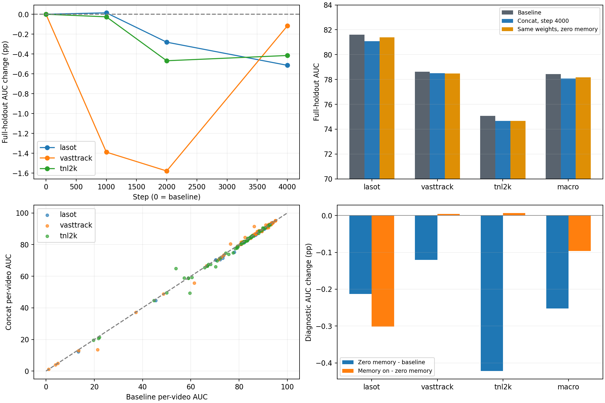
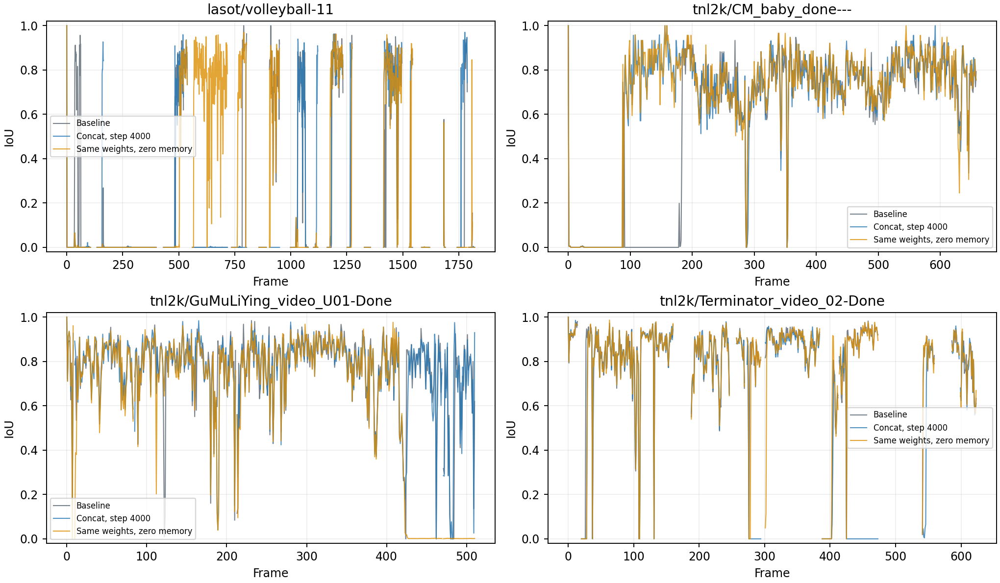
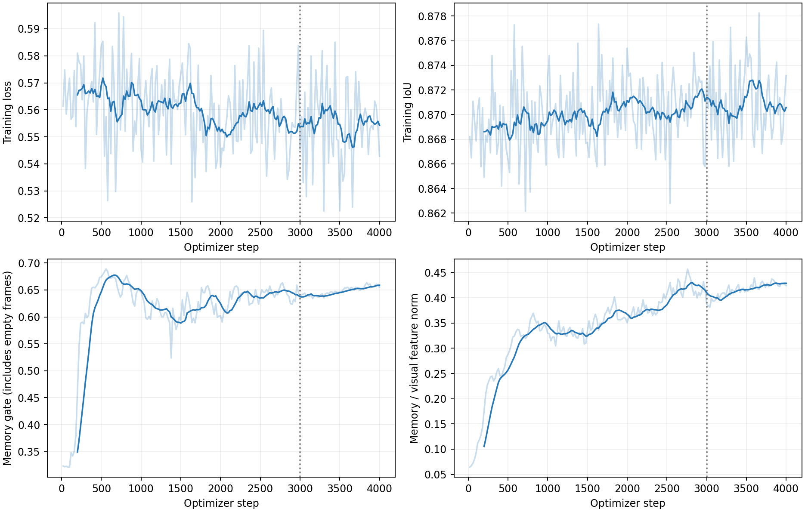
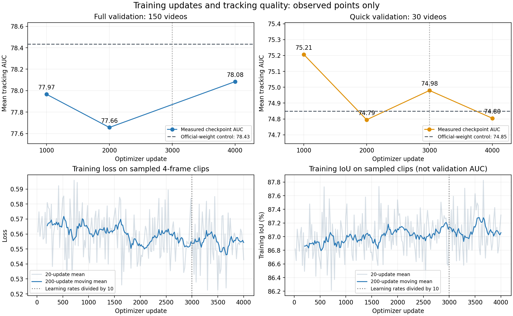

# 记忆拼接 CENTER：训练后效果与原因分析

更新时间：2026-11-04，北京时间。实验为`memory_concat_2gpu_20261103_run01`，
分支`codex/xmem-concat-center`。本轮4,000步训练已成功完成，未重新训练或延长预算。
本次新增的是同权重、同150条留出验证的零记忆输入消融，并分析已有逐帧预测。

## 结论与适用范围

**这轮“记忆模块＋直接拼接＋CENTER联合微调”没有超过无内容记忆的基线。**
三来源等权平均AUC从78.4331降为78.0844，低0.3486个百分点；PRE基本持平，NPR略降。
不能将此结论扩展为“拼接一定不如残差”，本轮没有同预算残差训练对照。

同一个4,000步模型把记忆输入置零后，平均AUC为78.1811。原CENTER已经在联合训练中改变，
即使不用记忆也未恢复到基线；开启记忆后又有小幅负向点估计，主要来自LaSOT。
这提示优先检查原预测头能力的保持，以及短片段训练能否覆盖在线记忆状态。
两项消融差值各自的不确定性较大，不能据此认定唯一原因或给出稳定因果占比。

这150条来自三数据集的官方训练部分，官方初始化可能已经见过；它是本轮适配留出集，
不是标准测试集。不能把本报告的78分与旧实验不同划分的60分直接比较。

## 精度结果

这里的“精度”是跟踪指标：AUC衡量不同IoU阈值下的成功率，PRE为中心误差不超过20像素
的比例，NPR为按目标宽高归一化后中心误差不超过0.2的比例。
训练IoU约87%是在训练裁剪上的指标，不是测试正确率。

| 条件 | 平均AUC | 平均PRE | 平均NPR |
| --- | ---: | ---: | ---: |
| 官方权重，无内容记忆基线 | 78.4331 | 81.9122 | 90.4695 |
| 4,000步权重，记忆输入置零 | 78.1811 | 82.1302 | 90.3022 |
| 4,000步权重，正常使用记忆 | 78.0844 | 81.9619 | 90.3172 |
| 正常记忆减基线／百分点 | -0.3486 | +0.0498 | -0.1522 |

平均方式为先按视频平均，再对LaSOT、VastTrack、TNL2K三个来源等权平均。
因此不是把所有帧混在一起统计一个分类正确率。

| 来源 | 视频数 | 基线AUC | 置零AUC | 正常记忆AUC | 开启记忆相对置零／百分点 |
| --- | ---: | ---: | ---: | ---: | ---: |
| LaSOT | 30 | 81.6061 | 81.3931 | 81.0918 | -0.3013 |
| VastTrack | 60 | 78.6137 | 78.4931 | 78.4973 | +0.0042 |
| TNL2K | 60 | 75.0794 | 74.6571 | 74.6642 | +0.0070 |



## 消融能说明什么

新增参数`--zero-memory-input`先按完整concat架构加载同一份已训练权重，然后旁路内容记忆，
使用模型已有的零填充路径给扩展CENTER输入256个零通道。保留所有已训练CENTER参数、
编码器、语言、置信度记忆、候选筛选阈值及评测协议。该条件不创建或写入内容记忆。
不能直接构建512通道基线头加载这个权重，否则不是同一个模型的输入干预。

先通过三来源各一条、最多30帧的检查，再在GPU4、5上用8个进程评完全部150条、116,372帧。
使用独立输出目录，没有复用原基线或正常记忆的预测。

从点估计可写出：

```text
正常记忆 − 原始基线 = (置零 − 原始基线) + (正常记忆 − 置零)
           -0.3486 =              -0.2520 +             -0.0967
```

这是当前联合训练模型的反事实分解。置零条件不是“只训练CENTER”的独立实验，
正常记忆与置零也会走不同的闭环搜索轨迹；不能把这两个数字当成严格的训练因果占比。

使用固定种子20261104，按数据来源分层、按已有`source_group`配对重采样20,000次。
TNL2K的60条来自32个同源组；LaSOT和VastTrack分别是30、60个组。

| 平均AUC差值／百分点 | 点估计 | 条件bootstrap 95%区间 |
| --- | ---: | ---: |
| 正常记忆减基线 | -0.3486 | [-0.6016, -0.1037] |
| 置零减基线 | -0.2520 | [-0.5521, +0.0125] |
| 正常记忆减置零 | -0.0967 | [-0.3061, +0.1444] |

这是固定本轮权重和留出集后的条件区间，未覆盖重复训练种子、全部跨视频相关性或选模不确定性，
不当作跨训练运行的显著性检验。尤其后两项区间跨0，不能确认哪个因素是稳定主因。

## 哪些视频受益或退步

正常记忆对比基线，以绝对变化0.1个百分点作为“基本持平”边界：
35条改善、90条退步、25条基本持平。只比较同一权重的记忆开启与置零，
则为34条改善、71条退步、45条基本持平。

| 视频 | 基线AUC | 置零AUC | 正常记忆AUC | 开启记忆的影响／百分点 |
| --- | ---: | ---: | ---: | ---: |
| TNL2K / Terminator_video_02-Done | 59.6078 | 59.0278 | 49.3971 | -9.6306 |
| TNL2K / GuMuLiYing_video_U01-Done | 74.3733 | 63.3865 | 74.6808 | +11.2944 |
| LaSOT / volleyball-11 | 13.3501 | 17.3410 | 12.1687 | -5.1722 |
| TNL2K / CM_baby_done--- | 53.8478 | 65.1420 | 64.7951 | -0.3468 |

TNL2K的平均读取增益接近0，并不意味着记忆从未生效，而是有较大的得失互相抵消。
CM_baby相对原始基线虽然提高10.9473个百分点，置零却更高，不能把它全部算作记忆模块收益。



## 为什么可能这样

### 原CENTER映射也被修改了

本轮训练所有CENTER参数，包括原视觉通道卷积、后续卷积和BN仿射参数；
冻结的只是BN运行均值和方差。相对初始化，原CENTER可训练参数整体相对L2变化约1.3612%，
三个首层视觉卷积分别变化约1.46%、1.62%、1.09%。这些不是“原CENTER始终保持不变”。
置零后仍低0.2520个百分点，是优先增加“保留原头映射”对照的直接依据；
但它不能证明所有差距都由头微调单独造成，因为这个头是与记忆共同适配的。

新增记忆通道有非零权重，17个记忆参数张量也确实更新。视觉/文本编码器和BN统计冻结审计
通过，指标没有非有限数。因此没有证据支持“模块没接上”“梯度完全没走”或训练发散的解释。

### 四帧训练覆盖不了很多在线记忆状态

每个片段重新建空库，只训练4帧，步长1～4，最多跨12个原视频帧；最后一帧之前最多写入3次。
训练平均短期条目约1.45、长期条目约1.07，远低于容量8/16。
完整在线验证中147/150条达到短期容量8，46/150条达到长期容量16。
LaSOT平均2,376帧，TNL2K平均648帧；这些状态与训练时的短历史明显不同。

这是已经由代码与容量统计确认的训练/推理差异。它可能导致模型没学会如何在满库、陈旧记忆、
长期错误积累时拒绝检索，但目前没有通过“长片段训练”对照证实它就是性能差距的原因。
[XMem原论文](https://arxiv.org/abs/2207.07115)研究的是分层记忆与长期维护；借鉴存储结构
并不意味着本项目已经获得相同的长时学习能力。

### 写入与搜索轨迹在训练时更理想

训练50%使用真值框写入，质量设为1；另50%使用当前预测框和得分。搜索裁剪仍围绕扰动真值，
预测写入也未完全经过在线的最终候选筛选。推理则从上一帧预测决定下一次裁剪，
用预测框、分类分数和MVLM阈值决定是否写入。

因此训练中看起来可靠的历史，在在线漂移后可能成为错误历史，再反馈到下一步。
这是根据实现提出的机制解释，不是已经统计确认的“错误写入率”。
序列学习中训练真值条件与推理自生成条件的差异及误差累积，在
[Scheduled Sampling原论文](https://proceedings.neurips.cc/paper/2015/file/e995f98d56967d946471af29d7bf99f1-Paper.pdf)
中有系统讨论；这里只借用这个概念，不把该论文的实验结论当成本项目的证据。

### 拼接增加灵活性，仍可能改变原预测分布

当前512维视觉与256维记忆拼接，直接进入CENTER的768输入卷积；没有额外768→512投影。
卷积首层在BN之前等价于：

```text
Conv([视觉, 记忆]) = W_visual * 视觉 + W_memory * 记忆 + bias
```

所以拼接后仍需学习怎样把两路信息合到预测中，只是两路有独立权重。相对原残差实现，
这次模型净增1,637,888个参数，表达更灵活，却不保证有用历史一定压过干扰历史。
记忆改变CENTER候选与分类分数，而图文相关性仍来自原视觉特征，线上又有固定阈值筛选；
训练裁剪上的定位损失改善不一定转化为整段在线跟踪改善。

训练loss从首1,000步平均约0.5647降为末1,000步0.5545，训练IoU从约86.91%升到87.09%，
属于有限改善。完整验证4,000步反而优于1,000/2,000步，也不能简单断言“训练越久越差”。
不建议据此直接增加轮次，或断言所有问题都是过拟合。

### 门控数值本身不是记忆正确率

最后1,000步门控均值约0.648，包含约26.1%的空库帧；按非空比例校正后约0.877。
在线按帧加权门控约为LaSOT0.899、VastTrack0.889、TNL2K0.961。
不能把训练含空库均值0.65与推理非空长序列0.95直接比较后断定门控失控。
门控也没有“记忆是否正确”的独立真值监督，数值大不等于检索正确。



## 运行成本与指标口径

本次完整150条验证墙钟：原基线765.65秒、正常记忆1,067.08秒、同权重置零715.34秒。
含加载、磁盘读取和两卡8进程调度，且运行时间段不同；仅是这次任务的成本记录，
不是单卡模型FPS或严格受控的推理性能基准。

原评测沿用仓库的首帧真值、整数预测、不可见/无效标注处理。复核发现VastTrack有55帧、
TNL2K有4,639帧无效框；现有`calc_seq_err_robust`把这些非LaSOT无效帧的归一化中心误差
置为-1，而NPR阈值计数将其算为命中。三个条件协议相同，原主分数保留以免悄改历史口径。
另附只对有效帧计算的诊断CSV/JSON；剔除无效帧后正常记忆的AUC仍低于基线。
这些附加值不混入主表，修订协议应同时重算所有对照，并另行记录。

## 训练步数与验证精度：是否步数不足

用户后续询问训练步数是否偏少，按已有日志单独整理如下。虚线是官方权重在同一留出集、
同一推理配置下的复现对照，不是论文表格分数，也不是另一分支重新训练的权重。



| 优化步数 | 完整150条平均AUC | 固定30条平均AUC |
| --- | ---: | ---: |
| 对应无内容记忆基线 | 78.4331 | 74.8491 |
| 1,000 | 77.9665 | 75.2068 |
| 2,000 | 77.6573 | 74.7949 |
| 3,000 | 未测 | 74.9796 |
| 4,000 | 78.0844 | 74.8045 |

**步数不足仍是一种可能，但这些观测不足以确认它是主因，更不能保证延长就会超过基线。**

- 完整验证从2,000到4,000步回升0.4271个百分点，4,000步是已测完整检查点中最好，
  支持“可能还有优化空间”，不支持“已经证明训练越久越好”。1,000到4,000步净增只有0.1179。
- 来源趋势不一致：LaSOT从1,000步81.6204降到4,000步81.0918；VastTrack从77.2256恢复到78.4973；
  TNL2K从75.0535降到74.6642。平均回升主要来自VastTrack，并非各来源都受益。
- 固定30条子集在1,000步最好，4,000步比它低0.4023个百分点。它与完整验证的趋势不同，
  不能把两种范围的分数接成同一条曲线，也不宜仅按小子集决定是否收敛。
- 训练loss和训练IoU只有缓慢改善，后者不是在线跟踪AUC。不能因为训练IoU约87%而预期验证AUC也应到87%。
- 第3,000步之后两个学习率都除以10。缺少3,000步完整验证，不能把2,000→4,000的回升
  精确归因到学习率下降，也无法仅用最后一个点判断验证平台期。

4,000步配合全局80个四帧片段，已经抽取320,000次片段、1,280,000次搜索帧，包含重复抽样，
不是128万张不同图像。这是从官方已训练模型出发的冻结编码器微调，不能与另一个分支完整复现
训练的epoch数直接对比。

还要区分**更新次数不足**与**历史长度不足**：即使再训练许多步，每次重新建空库并只看4帧，
也不会自动让模型经历满8/16条记忆的长闭环轨迹；这类差异不是单纯增加更新次数就消失。

如果专门验证“步数不足”这个猜测，可以另开续训实验，从4,000步恢复模型和AdamW，
保持末段低学习率（记忆1e-5、CENTER1e-6），先续到6,000步，每500步保存、每1,000步做同一150条验证，
固定其余策略及4,000步对照。若要更改原头冻结或片段长度，应作为独立实验。
这是验证方案，尚未启动；实际执行时需显式扩展当前入口的4,000步预算并使用新目录。
当前不根据曲线外推6,000步分数，也不承诺会超过78.4331。

W&B对应验证字段为`val/full150/mean_AUC`，横轴字段为`val/global_step`；
训练IoU对应`train/IoU`和`global_step`。图中只画真实测过的点，3,000步没有完整验证数据。
绘图入口`tracking/plot_memory_training_steps.py`，图表源数据见`steps_vs_accuracy.json`。

## 建议的下一轮顺序

1. **先验证原头保护。** 固定数据、种子、预算与其它策略，冻结原CENTER视觉映射、后续层及BN仿射，
   只训练记忆模块和新增输入权重；置零时应能回到原基线。新增/原有卷积通道需正确拆分或保护，
   不能只冻结整个CENTER而使新增零通道也无法学习。
2. 在此基础上单独验证4→8→12帧课程、预测状态驱动裁剪、逐步提高预测写入比例，
   让训练真正经历较长历史和自己的错误。按搜索帧总量对齐预算，并记录优化步数差异。
3. 再比较同初始化、同数据、同预算的残差与拼接，至少补重复种子。当前没有依据宣布拼接更好。
4. 若稳定超过留出基线，再固定配置做标准测试集评测。当前保留本轮权重作为对照，不自动继续训练。

以上是后续建议，尚未启动这些训练。本次用户已授权中断时恢复未完成的训练；
但本轮训练已完成，因此本次执行的是分析和推理消融。

## 产物与复现

- [结构与正式训练记录](MEMORY_CONCAT_TRAINING_20261103.md)
- [数值分析与逐视频结果](memory_concat_2gpu_20261103_run01/analysis/)
- [W&B原训练运行](https://wandb.ai/2896287267-hit/mvlm-memory/runs/65be0b58)
- 2026-11-04 13:10已直接核验W&B服务端：`finished`、`global_step=4000`、
  `analysis/status=completed`，三组精度、配对差值和三张图均有云端记录；
  证据为精简档案中的`analysis_wandb_verified.json`。
- 最佳已验证权重：`output/memory_concat_2gpu_20261103_run01/checkpoints/MVLM_step004000.pth.tar`，
  SHA256为`005807b6de6ae0391b18d097c495c0b33022182bc7bdea69148df6238f52478e`。
- 诊断运行：`output/memory_concat_2gpu_20261103_run01/analysis_20261104/`，含命令、源码哈希、完整预测和日志。
- 分析脚本：`tracking/analyze_memory_concat_run.py`；主要评测协议未修改。

复跑时在新的输出目录调用原评测入口并增加`--zero-memory-input`，绑定`CUDA_VISIBLE_DEVICES=4,5`。
分析入口使用`--run <实验目录> --out <新分析目录> --zero-metrics <置零评测metrics.json>`。
数据、权重、逐帧预测及大运行日志不纳入Git；保留精简数值和图表。
