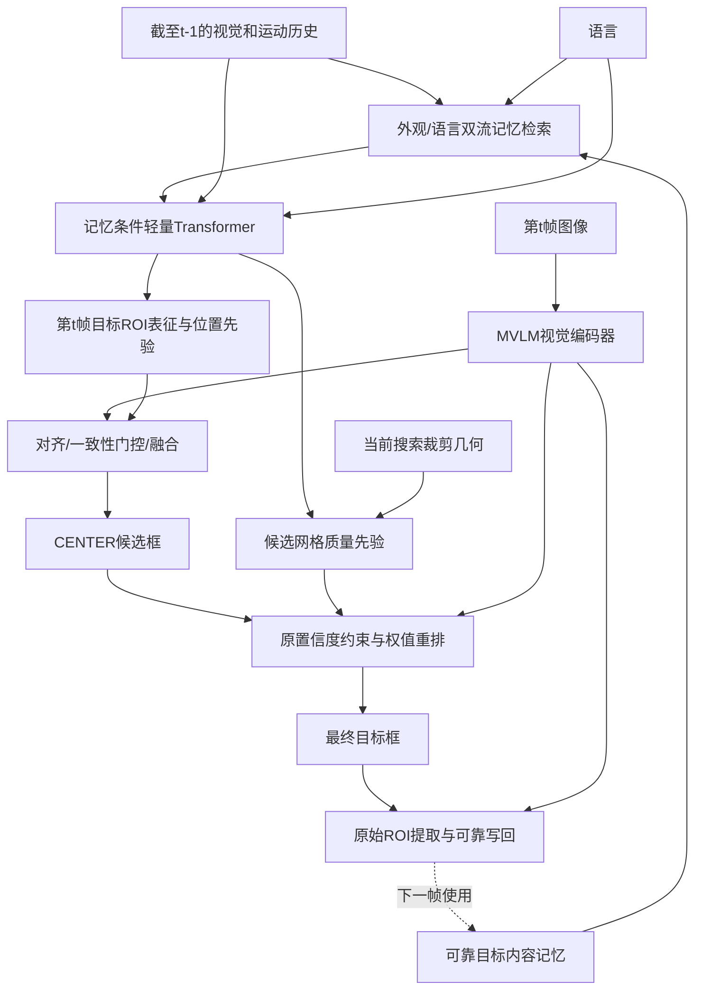

# 内容记忆与世界模型联合实现

更新日期：2026-11-09。分支 `codex/memory-world`，基于复现分支 `ef589b4`，首版代码为 `076e29c`。
这是开题报告图3-2的首版实现，复用 `codex/world-model@98a0094` 与
`codex/xmem-concat-center@c71ac15` 的相关模块。2026-11-09已启动[两卡A阶段运行流程](MEMORY_WORLD_STAGE_A_20261109.md)，尚无完整训练与精度结论。

导航：[分支总览](../../BRANCH_MEMORY_WORLD.md) · [训练方案、参数与完整命令](MEMORY_WORLD_TRAINING.md) · [实验索引](README.md)。

## 与开题架构的对应

| 开题设计中的功能 | 当前实现 |
|---|---|
| 可靠目标记忆与语言条件读取 | 短/长期内容库，外观与语言双流读取，包含几何、年龄和质量元信息 |
| 基于历史想像未来目标状态 | 两层轻量 Transformer，输出下一时刻 ROI 表征、框变化及质量隐变量 |
| 观测与未来表征融合 | 默认几何约束交叉注意力残差；另提供几何对齐后的通道拼接配置 |
| 候选权值与目标选择 | 预测网格质量先验，在原 MVLM 可靠候选集合内重排 |
| 定位后更新记忆 | 原始观测 ROI 的可靠写回，训练与在线共用时序核心 |

本版落实的是单步特征与运动回归；扩散去噪、多步自回归及跨训练片段继承记忆均未实现。

## 数据流与因果边界



世界模型在第t帧定位前仅读取截至t-1的历史。它同时读取上一已完成帧的池化搜索特征、
最近四帧的ROI/几何/质量状态以及更久的内容记忆。预测在已知目标帧号时计算，支持不等帧间隔；
未使用当前或未来图像提前生成预测。定位完成后才提交当前观测。

原始搜索特征为`[B,196,512]`；目标ROI为`[B,4,512]`。记忆状态含全图归一化xywh；
运动历史和预测框使用全图归一化cxcywh；裁剪区域为全图归一化xywh。
全部转换复用实际像素裁剪起点，避免混用坐标约定。

## 模块与接口

| 文件 | 职责 |
|---|---|
| `lib/models/mvlm/memory.py` | 每样本独立短/长期库，因果读写、可靠性和冗余淘汰 |
| `lib/models/mvlm/memory_reader.py` | 外观与语言条件双路读取，质量/时间偏置和状态编码 |
| `lib/models/mvlm/world_model.py` | 未来ROI外观、运动和质量隐变量预测 |
| `lib/models/mvlm/quality_head.py` | 用过去隐变量与当前裁剪几何产生候选网格质量先验 |
| `lib/models/mvlm/future_fusion.py` | 位置约束交叉注意力残差，或ROI几何变换后通道拼接 |
| `lib/models/mvlm/temporal_core.py` | 训练/在线共用定位、候选选择、原始ROI写回和状态更新 |
| `lib/models/mvlm/joint_checkpoint.py` | 基线初始化、concat通道迁移、结构与阶段检查 |
| `lib/train/actors/memory_world.py` | 因果片段展开与跟踪/预测/候选IoU监督 |
| `tracking/train_memory_world.py` | A/B/C训练、torchrun、恢复、数据/源码审计与可选监控 |
| `tracking/evaluate_memory_world.py` | 同一留出集的完整视频在线评测 |

`mvlm.py`负责装配，运行时历史不进入模型检查点。语言切换清空内容库、最近历史和前一帧上下文。
置信度聚合及局部/全局门控沿用原形式；质量先验只在原可靠候选集合内调整排序，空集合保留原回退。
预测与观测不一致时降低注入/重排强度，并额外控制内容写入；历史不足时以原置信度启动记忆。

质量头预测的是固定候选位置的事前质量先验，并未提前看到实际候选宽高/偏移。
监督为当前实际候选对当前GT的IoU，候选标签停止梯度。报告图中的框位移与候选权值在代码中为不同输出。
本版是单步潜空间回归，不实现扩散去噪或多步自回归。

## 分阶段训练

- A：冻结视觉/文本/CENTER，训练记忆读取、世界模型与质量头；未来特征和运动使用时序框标注监督。
  旁路未来表征注入和候选质量重排；允许显式teacher forcing，但写入只发生在该帧预测之后，验证始终使用预测历史。
- B（原开发配置）：世界模型及其记忆读取冻结，训练融合适配层。交叉注意力默认保持原CENTER冻结；
  concat配置训练扩展CENTER，BN运行统计固定，BN仿射参数随头更新。
- C：从B/C权重加载，小学习率联合微调新增模块，保留预测与跟踪监督；默认编码器与CENTER继续冻结。
- B（2026-11-11 当前实验）：专用 `TrackerStageB` 子类训练视觉编码器、CLIP 输出投影、CENTER 和融合，CLIP 本体与 A 模块冻结；使用定位 + CM 损失、按帧反向传播，详见[完整跟踪器 B 记录](MEMORY_WORLD_TRACKER_B_20261111.md)。旧入口的 B 冻结策略保持不变。
- 仅记忆：B阶段从同一基线开始，训练读出/融合，仍使用统一在线展开。
- 仅CENTER：`mvlm_TF_head_only_stage_b`从同一基线开始，旁路预测注入和质量重排，仅更新CENTER；BN统计固定。

新增模块按独立固定种子初始化，保证单模块/联合配置中的共享模块初始参数一致。
训练使用显式AdamW与按更新次数的cosine调度，预算由`TRAIN.WORLD.MAX_STEPS`控制。
训练从明确官方训练清单划分的独立视频集采样，三个来源比例实际参与片段抽样；
默认LaSOT/VastTrack/TNL2K为1:1:1，随后在来源内按视频均匀采样。
12帧片段、随机间隔1到4、前4帧无梯度预热为开发起点，并未验证最优性。
`WARMUP_FRAMES`控制只更新历史/记忆、不计算训练损失的前缀；研究长库状态时可同时增大
`CLIP_LENGTH`与预热长度。前缀使用同一在线定位/写入规则，验证禁用teacher forcing。
本版不跨视频或独立训练片段继承运行时记忆；预热后实际入库数量仍取决于可靠性门控。

### 默认阶段参数与运行入口

| 阶段 | 新增模块初始学习率 | 更新次数 | 损失 | 历史来源 |
|---|---:|---:|---|---|
| A | `1e-4` | 4000 | 外观 + 运动 + `0.5 ×`候选质量 | GT/预测混合，预测比例前1000步升至0.5 |
| B | `1e-4` | 4000 | `2 ×`GIoU + `5 ×`L1 + Focal | 预测 |
| C（可选） | `1e-5` | 4000 | 跟踪与预测联合监督 | 预测 |

A → B 是基本训练流程，B为首个可在线评测的联合检查点；C作为后续实验与B成对比较。
数据清单准备、参数键、单/多卡启动、断点恢复和评测的完整命令统一维护在[训练指南](MEMORY_WORLD_TRAINING.md)。

划分工具默认按来源从训练视频留出约10%，排除已知TNL2K帧/标注不一致序列，短于片段的视频记录为排除项。
其他缺失/异常默认报错；`--allow-incomplete`显式允许并记录部分语料。
清单检查视频身份、真实目录及图像路径交叉，保存标注/可见性/语言/路径签名，
不等同于全量图像内容去重。官方初始化可能见过适配留出视频，报告时需说明。

B加载A权重，C加载B/C权重；不同阶段共享同一清单、基线和MODEL/DATA/TEST设置。
中断恢复使用`--resume`，从最近保存状态恢复网络、优化器、学习率、逐rank RNG和样本位置；
配置、源码、数据或进程数变更会拒绝静默恢复。冻结CLIP本体省略于检查点，重载使用同一预训练缓存。
普通MVLM配置默认关闭新增模块。按固定片段loss保存的`best_clip_loss`不代表完整视频AUC最优。

### 成对配置与消融

- 联合：`memory_world_stage_a` → `memory_world_stage_b`。
- 拼接：`memory_world_concat_stage_a` → `memory_world_concat_stage_b`。
- 无质量分支：`memory_world_no_quality_stage_a` → `memory_world_no_quality_stage_b`。
- 仅世界模型：`world_only_stage_a` → `world_only`。
- 仅记忆：`memory_only`，直接B阶段；仅头：`head_only_stage_b`，直接B阶段。
- 原模型：`memory_world_baseline`，使用官方MVLM权重和原坐标回映射评测。
- 同坐标基线：`memory_world_coordinate_baseline`，使用相同官方权重，关闭内容/预测/权值，
  通过共同在线核心进行精确裁剪回映射；联合模型和仅头对照应优先与这一条件比较。

以上名称统一加`mvlm_TF_`前缀，文件位于`experiments/mvlm/`。不同结构的A/B配置必须成对使用，
不能直接拼接旧独立分支训练后的检查点。相同模型关闭读取可清空内容库做诊断；
`QUALITY_WEIGHT=0`可进行同权重无重排对照，权重系数不是结构参数。

当前concat仅提供成对A/B配置；默认C为交叉注意力配置，不能直接接在concat B之后。

### 完整视频在线评测

入口为`tracking/evaluate_memory_world.py`，使用与训练相同的留出清单，分别评测B/C检查点及同坐标基线。
命令和输出字段见[训练指南](MEMORY_WORLD_TRAINING.md)。

沿用main首帧GT计分、整数框保存、原无效帧/可见性处理与PRE@20/AUC/NPR@0.2口径；
首帧GT不会写入新增内容库。精确裁剪回映射与旧路径可能存在像素舍入差异，
初始化特征/头输出一致不等同于与旧坐标路径的整段预测逐帧一致；提供同坐标基线以控制这一因素。
需要严格首帧预测协议时可使用原`tracking/strict_language_eval.py`。
原历史评测对非LaSOT无效帧的NPR约定仍保留，不把本版分数与不同口径混用。

## 验证

CPU回归入口：

```bash
cd /root/MVLM
MVLM_DEVICE=cpu OMP_NUM_THREADS=1 /root/miniconda3/envs/mvlm/bin/python -m unittest discover -s tests -v
```

22项检查全部通过，包含小模型A→恢复→B→C训练、实际图像片段加载、在线权重重载与语言重置。
真实FastITPN/CLIP官方权重CPU预检覆盖512→768接口、非空记忆读取、未来ROI与196维质量输出、
新增模块梯度及编码器冻结；结果见[memory_world_preflight_20261108.json](memory_world_preflight_20261108.json)。
可重复运行`tracking/check_memory_world.py --baseline models/MVLM_TF.pth.tar`。
双进程CPU/Gloo检查覆盖A/B/C及一侧无监督样本的副本一致性；多卡GPU/NCCL与长视频吞吐量尚未验证。

2026-11-09更新：新增A阶段`BATCHED_ENCODER`路径，批量执行同一时刻的编码、记忆读取、世界预测、质量头和候选评分，独立维护各视频状态。26项回归检查及真实两卡GPU/NCCL短测通过；完整大batch参数、显存扫描与运行边界见[训练记录](MEMORY_WORLD_STAGE_A_20261109.md)。上一段为11月8日的历史预检范围。
