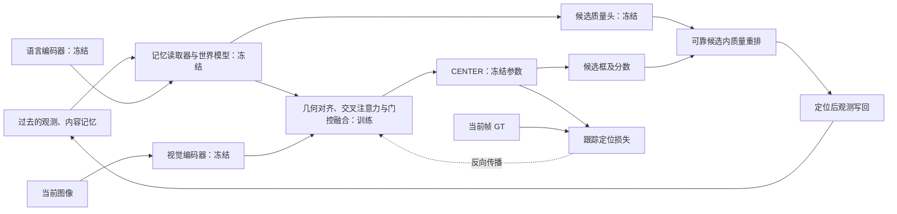

# 联合模型 B 阶段训练方案

日期：2026-11-11（北京时间）。状态：**正式 B 已从 A/3000 开始更新，W&B 云端已确认收到训练指标；A 继续运行**。

用户最新要求 A 继续运行，同时在其他空卡训练 B。原第 3000 步停止控制器已取消，A 继续使用 GPU 0、1，按原 4000 步 cosine 计划运行。B 使用另外两张空闲 RTX 3090（GPU 2、3），互不占用对方的卡。

## 目标与初始化

B 的目标是学习将 A 阶段预测的目标外观、运动位置与当前图像观测融合，使联合模型在完整视频跟踪中产生收益。

使用同一官方 MVLM 基线、同一数据清单，以及用户指定的 **A 第 3000 步检查点** `output/memory_world_stage_a_2gpu_20261109_run02/step_003000.pth.tar`，记录父权重 SHA256。该文件是独立保存的不可变节点；不使用随 A 后续训练更新的 `last.pth.tar`，也不替换成 A 的最佳片段损失权重。

在第 3000 步尚未到达时，用第 2950 步权重做容量和实现验证，产物放在独立 smoke/profile 目录。正式 B 会重新加载第 3000 步权重，丢弃短测的优化器状态和更新。

B 重新创建优化器和调度器，从 B 第 0 步开始；不会继承 A 的学习率、优化器动量或运行时记忆。MODEL、DATA、TEST 设置与父 A 保持一致，结构继续采用 `cross_attention`。

> 本文记录最初的“仅融合层 B”实验，已于 2026-11-11 停止并保留第500步权重。用户要求重新试训后，当前改用[完整跟踪器 B](MEMORY_WORLD_TRACKER_B_20261111.md)。下文的冻结范围、低显存数字和 W&B 链接均属于旧实验。

## 更新模块与数据流

| 模块 | B 的行为 |
|---|---|
| 视觉编码器、文本编码器 | 冻结 |
| 内容记忆读取器、世界模型 | 加载 A 权重，冻结 |
| 候选质量头 | 加载 A 权重，冻结；参与可靠候选集合内的质量重排 |
| 未来信息融合层 `future_fusion` | 训练，包含投影、交叉注意力、门控与残差输出，约 65.8 万参数 |
| 原 CENTER 定位头 | 冻结参数及 BN 统计；反向传播仍穿过它到达融合层 |
| 记忆库、时序历史 | 每个片段独立创建的运行时状态，不是可训练参数 |



## 数据与片段流程

- 沿用 `/root/MVLM/output/memory_world_split/manifest.json`：43259 个训练视频、4807 个验证视频，按视频隔离，官方测试视频不参与适配训练。
- LaSOT / VastTrack / TNL2K 按 `1:1:1` 概率选择来源，再在来源内均匀选择视频、随机截取片段；每批不强制精确等量。
- 每个片段 12 帧，采样间隔随机 1～4。前 4 帧无梯度建立历史，后 8 帧在监督有效时计算定位损失。
- B 的训练与验证全部使用模型预测的观测写入历史，GT 只用于当前帧完成定位后的监督，不做 A 的 GT 历史混合。
- 每个片段独立维护记忆、历史、搜索区域和可靠性状态，片段之间不继承状态。

## 损失

```text
L_B = 2 × L_GIoU + 5 × L1 + L_focal
```

GIoU 与 L1 监督预测框的位置、尺寸；Focal 监督位置响应图。B 不继续优化 A 的外观、运动或质量损失。B 的总损失尺度与 A 不同，不能用 A 的约 0.39 作为 B 的收敛目标。

## 并行训练参数

| 项目 | 建议 |
|---|---|
| 显卡 | GPU 2、3，两张 RTX 3090 24GB；A 继续占用 GPU 0、1 |
| 每卡 batch | **40 个片段，全局 80**，无梯度累积；按用户 batch=80 的全局含义准备，已询问是否希望改为每卡 80 |
| 更新预算 | 上限 4000 次更新；500、1000 步作为首轮效果检查节点，根据验证证据决定是否提前结束 |
| 样本预算 | 完整 4000 步名义采样 320000 个片段；提前结束记录实际更新与样本数 |
| 优化器 | AdamW，初始 LR `1e-4`，weight decay `1e-4`，默认 betas/eps |
| 调度 | 按预定 4000 步 cosine 降至 0；不在同一实验中静默修改调度预算 |
| 梯度裁剪 | 范数上限 `1.0` |
| 数据加载 | 每卡 4 个 worker，每个 OpenCV 单线程；进程文件句柄上限 32768 |
| 精度 | 沿用当前实现；不同时引入 AMP 等额外变量 |
| 片段验证与保存 | 每 50 步保存并验证固定 96 个片段，来源采样概率仍为 `1:1:1`，不承诺精确各 32 个 |
| 正式运行 | 独立输出目录、源码与配置快照，记录 A 父权重 SHA256 和实际 batch |

为保持 A 的源码签名与精确恢复能力，A 的模型、actor 和原训练入口均未修改。新增 `tracking/train_memory_world_stage_b.py` 和 `tracking/memory_world_stage_b_actor.py`：同一时刻对多个片段批量计算冻结编码器、融合层和 CENTER；每个片段仍独立持有记忆库与历史，当前帧定位后才写回。CENTER 保留输入梯度，参数和 BN 统计冻结。B 的 `tracking/world_manifest_fast.py` 使用目录项元数据识别图片符号链接，减少逐图片文件查询；保留原清单读取器的标注、可见性、指纹、路径重叠及官方训练来源检查，不使用旧缓存跳过当前数据核验。新入口单独记录上述三个新增文件的源码快照和签名。配置中的 `BATCHED_ENCODER` 是原 A 路径开关，保持关闭；B 的批量实现由专用入口选择。

单卡真实片段短测（父权重为 A/2950，每组两次更新，取第二步计算时间；未计数据读取和正式两卡通信）如下：

| 执行方式 | 每卡片段数 | 计算时间 | 峰值 allocated / reserved | 检查 |
|---|---:|---:|---:|---|
| 原顺序路径 | 40 | 19.35 秒 | 2.56 / 2.59 GiB | 融合层更新，冻结参数不变 |
| 新批量路径 | 40 | 7.82 秒 | 2.98 / 3.20 GiB | 融合层更新，冻结参数不变 |
| 新批量路径 | 80 | 13.35 秒 | 4.72 / 5.22 GiB | 融合层更新，冻结参数不变 |

batch 80 两卡可放下，不需要增加到四卡。B 只训练约 65.8 万参数，冻结编码器且历史停止梯度，因此该 batch 下显存占用不会接近 24GB。显存余量不等于算力闲置；不通过增加无用张量来占满显存。新批量路径每卡 40 的计算吞吐约为原顺序路径的 2.5 倍；正式吞吐仍需两卡运行确认。

新增 CPU 检查覆盖 B 批量与顺序实现的损失、各模块梯度、独立时序状态，以及三种数据来源的核验结果和跨分区图片别名拒绝。真实编码器单帧对照的平均特征绝对差约 `1.90e-4`，特征 RMS 约 `0.824`，两例最高响应位置一致；GPU 批量运算含 CLIP 的浮点舍入差异，不承诺完整在线轨迹逐帧完全相同。

## 启动前验证与监控

1. 确认 A 第 3000 步验证与保存完整提交，核验父权重与 B 的 MODEL/DATA/TEST、数据签名、基线签名一致；A 继续训练。
2. 在独立临时目录做少量真实 B 更新，检查融合层有梯度并更新，冻结模块不更新，损失有限，保存/重载正常，两卡副本一致。
3. 已比较每卡 20/40 的顺序路径、每卡 40/80 的批量路径；全局 80 优先使用两卡各 40。短测权重不混入正式初始化。
4. 用固定父权重重新初始化正式 B，使用独立 W&B 运行，沿用已授权项目和数值指标上传范围。网络不可用时训练写本地日志，监控连接独立重试，不让联网阻塞训练。

专用 B 入口记录总损失及未加权的 `giou_loss`、`l1_loss`、`focal_loss`，两卡按有效监督帧数聚合；总损失等于 `2*giou_loss + 5*l1_loss + focal_loss`。还记录梯度、学习率、有效监督、预测计数、显存与吞吐。W&B 桥接仅上传数值指标、超参数和显卡曲线，不上传代码、数据、图片或权重；固定验证片段的三个分项按监督帧数汇总。

## 判断 B 是否有效

- 训练过程检查 B 自身的定位损失与固定片段验证损失，不直接比较 A/B 的 loss 绝对值。
- 在第 500、1000 步等候选节点，用预先固定的验证视频集合做完整在线跟踪，与同坐标 MVLM 基线比较 AUC、PRE、NPR。重点查看遮挡后重现、快速运动和干扰目标场景。
- 优先用固定的小型视频验证集合检查方向，再扩大至完整留出集。当前 `tracking/evaluate_memory_world.py` 默认遍历全部 4807 个验证视频；若采用固定子集，应增加原验证清单内的视频选择入口，不能更换训练清单绕过签名检查。
- 固定片段损失最低的检查点不一定具有最高完整视频 AUC。保留若干候选检查点，在相同视频及同一计分协议下比较，之后确定最终 B 权重。
- 若 B 有明确收益，再决定是否做 C 的联合微调。模型与参数确定后，再统一报告独立官方测试集结果。

正式 B 的 [W&B 监控](https://wandb.ai/2896287267-hit/mvlm-reproduction/runs/ylxp2wpf)已启用；A 的 [W&B 监控](https://wandb.ai/2896287267-hit/mvlm-reproduction/runs/ngk6l0q4)继续独立运行。

## 本次两卡短测与正式初始化

真实两卡短测完成 2 次更新，批量为 `40×2=80`。两卡融合层权重 SHA256 一致，训练参数确实更新，冻结参数版本与梯度检查均通过；两次固定 6 片段验证损失分别为 `0.651420`、`0.649331`。该短测只用于检查实现和资源，不作为跟踪精度结论。

第二步耗时 `8.69` 秒；两张卡采样到的系统显存峰值分别为 `3783`、`3785 MiB`，PyTorch 峰值 allocated 约 `3047 MiB`、reserved `3352 MiB`。第一步 `106` 秒包含数据加载进程启动，不用于估算稳定训练速度。完整证据见 [预检记录](memory_world_stage_b_preflight_20261111.json)。

正式初始化采用 A 第 3000 步权重，SHA256：`1809a2591f5b119cd221628eac9ffa510d7fc26a6a014d7edbdbce0901f81b16`，A/3000 固定片段验证损失 `0.3931843121`。B 于北京时间 19:57:26 启动独立正式进程，重新核验当前数据、创建优化器；A 已继续超过第 3000 步。训练与 W&B 实际更新状态以服务器文件和云端记录为准。

北京时间 20:08:13 通过 W&B 远端 API 核验：运行 `ylxp2wpf` 为 `running`，云端已收到 B 第 6 步，配置明确记录 stage B、A/3000、两卡各40、全局80。总损失、GIoU/L1/Focal、梯度及 GPU2/3 显存曲线均已上传。本地当时已完成至少7步，全部数值有限，没有跳过片段；A 已继续至3014步。正式前几步存在片段难度和读取时间波动，尚未到第50步固定验证节点，不据此判断跟踪精度收益。

正式进程：监督进程 `1005059`，两卡启动进程 `1005060`，rank0 `1005067`；W&B 桥接进程 `1005495`。进程号为本次启动快照，后续以状态文件为准。A 的22个源码签名、B 的25个源码签名均核对一致。

## 服务器状态入口

- 正式配置：`experiments/mvlm/mvlm_TF_memory_world_stage_b_2gpu.yaml`。
- 短测输出：`output/memory_world_stage_b_smoke_2gpu_b80_20261111_run02`；旧短测在逐图片核验阶段被主动结束，没有优化器更新。
- 正式输出：`output/memory_world_stage_b_2gpu_b80_20261111_run01`。
- 独立启动控制：`output/memory_world_stage_b_setup_20261111/formal_run01/starter_status.json`；只在短测副本/冻结检查通过、A/3000 原子检查点可读取且 GPU 2、3 空闲时启动 B，不发送任何 A 停止信号。
- 父权重记录：同目录 `parent_checkpoint.json`；进程与显卡记录：`supervisor_status.json`、`gpu_resources.jsonl`、`train.log`。
- W&B 元数据：正式输出中的 `wandb_run.json`；桥接状态：`wandb_bridge_status.json`。监控重试不阻塞训练，云端同步是否正常需通过远端记录确认。
- 并行任务使用独立随机通信端口，避免依赖 A 的通信服务。
