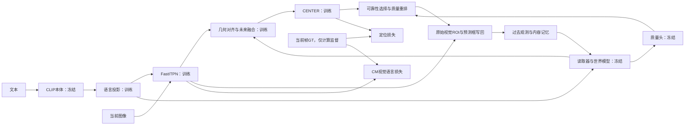

# 完整跟踪器 B：重新试训与观察记录

日期：2026-11-11；分支 `codex/memory-world`。本次按照用户要求重新训练并观察损失。

## 为什么重做 B

旧 B 仅训练 `future_fusion` 的 657921 个参数。视觉编码器与 CENTER 虽在显卡上，但不保留视觉反向图，因此 batch80 时每卡只占约3717MiB。这是训练范围差异，不是 batch80 没有生效。旧 B 的第50～500步固定验证定位损失在约1.12～1.16之间，没有持续改善。

旧实验已结束，保留 `output/memory_world_stage_b_2gpu_b80_20261111_run01/step_000500.pth.tar`，SHA256 `2a783553d2d15d5d7eebf45cb7518e3e23b8a28543ee07fdcaa451afa2dd390f`；停止时实际已完成506步，末尾6步没有保存。旧 W&B `ylxp2wpf` 只作为对照，状态已标记 `stopped_for_protocol_change`。

新 B 使用相同的 A/3000 父权重，重新初始化，不继承旧 B 或容量短测的优化器与训练结果。A 保持运行。

## 当前训练范围

| 模块 | 行为 | 参数量 |
|---|---|---:|
| FastITPN-B 视觉/跨模态编码器 | 训练，启用原训练模式 | 84343936 |
| CLIP 输出语言投影 | 训练 | 393728 |
| CENTER 定位头 | 训练参数及 BN 运行统计 | 4704645 |
| 未来融合层 | 训练 | 657921 |
| CLIP 本体 | 冻结，eval | 427616513 |
| 记忆读取器、世界模型、候选质量头 | 加载 A/3000，冻结，eval | 2908167 |

共 **90100230** 个可训练参数。不是解冻 CLIP 本体，也不是继续训练 A 的预测目标。完整模型放到指定显卡；记忆和历史仍是每视频独立的运行时状态。



定位、裁剪、质量重排与写回共用原在线核心；GT 不进入定位或记忆写回。训练计算图覆盖当前帧的视觉编码、投影、融合和定位，不跨历史反传。

## 损失、批量与显存

```text
tracking_loss = 2*giou_loss + 5*l1_loss + focal_loss
loss = tracking_loss + 0.5*cm_loss
```

CM 使用 FastITPN 输出的 `tae`，语言77个 token 与视觉196个 token 的划分、目标网格与 top10 背景负样本同原 CM 实现。已通过原实现的数值及梯度等价测试。缺少前景/背景网格的样本不贡献 CM，单独记录 `cm_valid_frames`；这部分计数可能少于定位监督帧数。

每卡40个独立片段、全局80。每个片段12帧，前4帧无梯度建立历史，后8帧有效时监督。逐帧反向传播立即释放视觉图，整个80片段批次只执行一次优化器更新。缓存冻结 CLIP 的输出，在每个学习帧重新执行可训练语言投影，避免复用已释放的投影计算图。无需减少 batch 或启用 AMP。

两卡显式同步每帧损失和对应的梯度和，再除以全局实际监督帧数；不是再次乘/除 DDP 平均因子。包含一侧无有效监督时的 CPU/Gloo 检查。BN 在每批开始前及验证保存前同步 rank0 统计，与原常规 DDP 的 buffer 规则一致。

## 超参数与数据

| 项目 | 本次设置 |
|---|---|
| 正式显卡 | 物理 GPU2、3；A 保留 GPU0、1 |
| 精度与 batch | FP32；每卡40，全局80；每8个学习帧积累后更新一次 |
| 学习率 | 编码器/投影 `1e-5`；CENTER `5e-5`；融合 `1e-4` |
| 优化器 | AdamW；weight decay `1e-4`；默认 betas/eps |
| 调度预算 | cosine 4000次更新；不得静默更换已有运行的预算 |
| 梯度裁剪 | 总范数上限0.1，日志中的范数为裁剪前数值 |
| 片段 | 长12、预热4、步幅随机1～4、全部预测历史 |
| 数据配比 | LaSOT:VastTrack:TNL2K = 1:1:1 概率采样，来源内视频均匀 |
| 数据量 | 原固定清单：43259训练视频、4807留出视频；视频隔离 |
| 加载 | 每卡4个worker，预取1批，使用打包片段传递 |
| 验证 | 启动第0步及每25步，固定96个片段；同时保存可恢复检查点 |

官方配置参考：[MVLM YAML](https://github.com/inha-vllab/MVLM/blob/main/experiments/mvlm/mvlm_TF.yaml)、[参数分组](https://github.com/inha-vllab/MVLM/blob/main/lib/train/base_functions.py)。原复现也训练视觉、投影与头，冻结 CLIP 本体；其头/编码学习率约为5e-4/5e-5。本次从已收敛官方跟踪权重微调，采用更小的学习率，并加入融合分组；不是声称完整复制论文的数据、裁剪或训练预算。

## 已完成的检查

- CPU：逐帧反向与保留计算图后统一反向的损失/梯度一致；新版 CM 与原实现数值/梯度一致；两进程含无监督 rank 的全局梯度归一化正确。
- 单卡真实容量测试：每卡40、FP32、2步；系统显存约22227MiB，Torch 峰值 allocated21211MiB、reserved21808MiB。四个预期训练模块参数均更新，冻结参数和梯度检查通过。
- 两卡真实短测：全局80、2步，第二步14.85秒；两卡训练权重 SHA256 相同，四个模块均更新，冻结模块未更新。训练 loss 两步约1.2681、1.0979；固定6片段 loss0.6207，只用于验证执行，不作为泛化收益。
- 检查点用原在线模型类 `MVLM` 重载成功；统一与训练相同的 cuDNN 确定性设置后，6片段各项验证指标与保存时完全相同，最大误差0。[重载记录](memory_world_tracker_b_reload_20261111.json)也保留默认cuDNN设置下约1e-3分项偏差的诊断；不能把不同数值计算设置下的小差异当作权重不兼容。
- 独立固定训练样本检查：2个训练片段重复优化20次，BN统计冻结以隔离优化问题；eval loss从0.128844降至0.066986，定位项从0.111582降至0.054841，CM从0.034523降至0.024288，IoU从0.961620升至0.983626。第15次评估的Focal项短暂升高，loss为0.144258，随后恢复；具体来源尚未逐帧分解，可能涉及在线裁剪、离散响应监督与训练时随机DropPath，不能据单点判断发散。该检查是容易训练片段的优化诊断，不是留出验证，也不把其权重用于正式运行。完整观测见[固定样本记录](memory_world_tracker_b_fixed_sample_20261111.json)。

容量测试输出 `output/memory_world_tracker_b_capacity_b40_20261111_run01`；两卡短测 `output/memory_world_tracker_b_2gpu_b80_20261111_smoke01`。两卡采样到的系统显存峰值均22243MiB，证据见[预检记录](memory_world_tracker_b_preflight_20261111.json)。短测与固定样本诊断使用的显卡4、5已释放，正式运行仅使用2、3。

## 正式运行与观察入口

- 配置：`experiments/mvlm/mvlm_TF_memory_world_tracker_b_2gpu.yaml`。
- 入口：`tracking/train_memory_world_tracker_b.py`；模型/actor/梯度同步：`tracking/memory_world_tracker_b.py`。
- 输出：`/root/MVLM/output/memory_world_tracker_b_2gpu_b80_20261111_run01`。
- 控制与日志：`/root/MVLM/output/memory_world_tracker_b_setup_20261111/formal_run01`。
- 状态：输出中的 `training_status.json`；训练数值 `metrics.jsonl`；验证 `validation_*.json`；控制目录的 `gpu_resources.jsonl`、`supervisor_status.json` 和 `train.log`。
- W&B（2026-11-12 12:20 快照）：[当前完整跟踪器 B](https://wandb.ai/2896287267-hit/mvlm-reproduction/runs/zovlqxy8)。北京时间11月12日12:20远端API显示只收到第100步、状态为crashed；这是代理断开与积压日志补传超时导致的监控状态，不是训练进程状态。本地 `metrics.jsonl` 完整至4000步，W&B原补传进程仍在重试；单独建立精简恢复曲线时初始化也因网络超时失败。仅授权上传数值指标、超参数和GPU资源，不上传代码、图片、数据或权重。[本地完整曲线](memory_world_tracker_b_20261111/observed_curves.png)不依赖云端。

正式第0步固定96片段：91个片段有有效监督，共700帧；总loss1.322150、定位项1.123143、GIoU0.306135、L1为0.031632、Focal0.352712、CM0.398015（加权0.199007）、IoU0.764546。该定位损失也说明旧仅融合 B 的约1.12～1.16平台接近未适配的初始化水平。后续按相同固定片段比较，不与新旧总loss直接混用。

新实现完全放在新增文件中，未修改 A 正在运行的已签名训练代码；新运行独立保存源码、配置、父权重和数据签名。正式运行重新核验当前数据；`--trial-data-cache` 仅允许不超过3步的容量测试，不能用于正式实验。

判断正常训练时同时看：loss 分项有限、四个训练模块梯度有效、监督帧数稳定、固定验证定位损失下降与 IoU 提升。新增 CM 后的总损失不能直接与旧 B 无 CM 的总损失比较，更不能要求等于原复现随机定位头的初始 loss。训练已经从训练好的权重开始，单步片段难度波动是预期现象。

如果训练下降而验证变差，优先检查 BN 统计、自由运行裁剪覆盖率、编码表征变化与冻结世界模型的不匹配；如果所有梯度或参数变化为零，先检查冻结与 no_grad；如果数值发散，检查目标尺度、loss 分项和梯度，再用独立实验调整学习率。最终是否提升跟踪精度仍以相同视频的完整在线 AUC/PRE/NPR 为准。

2026-11-12 后续：已创建 [W&B 恢复运行](https://wandb.ai/2896287267-hit/mvlm-reproduction/runs/wiy4jneg)，本地指标排队补传；上传请求仍出现超时，尚未核实远端收到完整曲线。原运行及本地记录保留。W&B 客户端还会尝试上传运行日志、依赖列表等自动生成文件；未主动上传代码、数据、图片或权重。

## 2026-11-12 复查：早期波动与训练后效果

此前第25步固定片段总loss上升至1.449633、裁剪内IoU降至0.724134，并不只是单步训练loss抖动。训练已于北京时间2026-11-12 12:14完成4000步，数值有限、四个预期模块均有非零梯度，最终两卡参数一致且冻结参数未变化。前100步训练总loss平均1.0592，第3801～3900步平均0.6814；第4000步固定片段总loss为1.0558。固定片段验证总loss的阶段均值从第25～500步的1.2515，降到第3000～3925步的1.1410。由于每次定位的裁剪和有效监督帧会变，这些loss不能单独作为完整跟踪效果。

对同一96个固定片段的预热后**全部731个可见且标注有效帧**，统计质量重排后的最终预测框与整图GT的IoU；目标跑出裁剪区域时也计入。这是无GT参与定位的短片段诊断，不是完整视频在线AUC：

| 模型状态 | 整图最终框平均IoU | IoU≥0.5比例 | 原裁剪内监督帧数 |
|---|---:|---:|---:|
| B初始化（A/3000） | 0.7186 | 0.7866 | 700 |
| B第25步 | 0.6884 | 0.7606 | 724 |
| B第25步，换回A的CENTER BN运行统计 | 0.7072 | 0.7934 | 714 |
| B第1025步（裁剪内验证loss最低） | 0.7391 | 0.8085 | 702 |
| B第1025步，换回A的CENTER BN运行统计 | 0.7306 | 0.8235 | 707 |
| B第3925步 | 0.7228 | 0.7893 | 716 |
| B第3925步，换回A的CENTER BN运行统计 | 0.7293 | 0.8194 | 722 |
| B第4000步 | 0.7278 | 0.8044 | 704 |
| B第4000步，换回A的CENTER BN运行统计 | 0.7366 | 0.8317 | 712 |

因此，BN运行统计确实是早期波动的一个因素，但换回旧统计在第1025步会降低平均IoU，在第3925步则提高该指标；阈值成功率和平均IoU也不总是同向，不能据此直接冻结BN或覆盖检查点。各CENTER BN的 `num_batches_tracked` 从第25步的300180增长到第1025步的312180，表明每次优化更新会随12帧前向更新12次统计，包括无梯度预热帧；与普通单帧训练的更新频率不同，值得在独立实验中控制。

关闭未来融合注入与质量重排（两者**同时**关闭，并保留该检查点的编码器和头）时，第1025步整图IoU为0.7331，第3925步为0.7219，第4000步为0.7265；开启时分别为0.7391、0.7228、0.7278。差值较小，在这96个片段上按片段配对重采样得到的粗略95%区间均覆盖0。片段可能来自同一视频，重采样仅供探索，不是正式统计结论。该对照不能分别归因于记忆库或世界模型，更不能作为最终贡献结论；数字及重采样结果见[复查数据](memory_world_tracker_b_review_20261112.json)。

当前可把1025和末期权重作为候选，在相同留出视频上做完整在线跟踪，并与同坐标MVLM、关闭注入/质量分支的模型比较AUC、PRE和NPR。若继续训练实验，应单独对比固定BN统计或降低每帧BN统计更新率，保留当前结果和优化器配置；不可只根据第25步或显存使用率决定学习率。

新增 `tracking/evaluate_memory_world_fixed_clips.py` 用于复用上述整图指标，可传入多个兼容检查点，也支持 `--reset-head-bn-from` 和 `--disable-temporal`。读取现有已核验的数据快照，检查数据、基线及模型结构签名；它是诊断工具，不替代完整视频评测。单片段实际GPU重载结果与原复查逐项一致。

## 手动启动示例

确认GPU2、3空闲，并使用不存在的新输出目录：

```bash
CUDA_VISIBLE_DEVICES=2,3 MVLM_DEVICE=cuda OMP_NUM_THREADS=1 \
/root/miniconda3/envs/mvlm/bin/python -u -m torch.distributed.run \
  --nnodes=1 --nproc_per_node=2 --rdzv_backend=c10d --rdzv_endpoint=localhost:0 \
  --rdzv_id=memory-world-tracker-b-new-run \
  /root/MVLM/tracking/train_memory_world_tracker_b.py \
  --config /root/MVLM/experiments/mvlm/mvlm_TF_memory_world_tracker_b_2gpu.yaml \
  --manifest /root/MVLM/output/memory_world_split/manifest.json \
  --baseline /root/MVLM/models/MVLM_TF.pth.tar \
  --world-checkpoint /root/MVLM/output/memory_world_stage_a_2gpu_20261109_run02/step_003000.pth.tar \
  --output /root/MVLM/output/memory_world_tracker_b_NEW_RUN \
  --device cuda --validation-clips 96 --initial-validation --verify-distributed
```

正式运行由原独立 supervisor 启动，并由独立 W&B 桥接记录。中断后使用相同配置、输出目录、进程数和源码加 `--resume`，恢复模型、AdamW、cosine、采样位置及各 rank 的 RNG。
