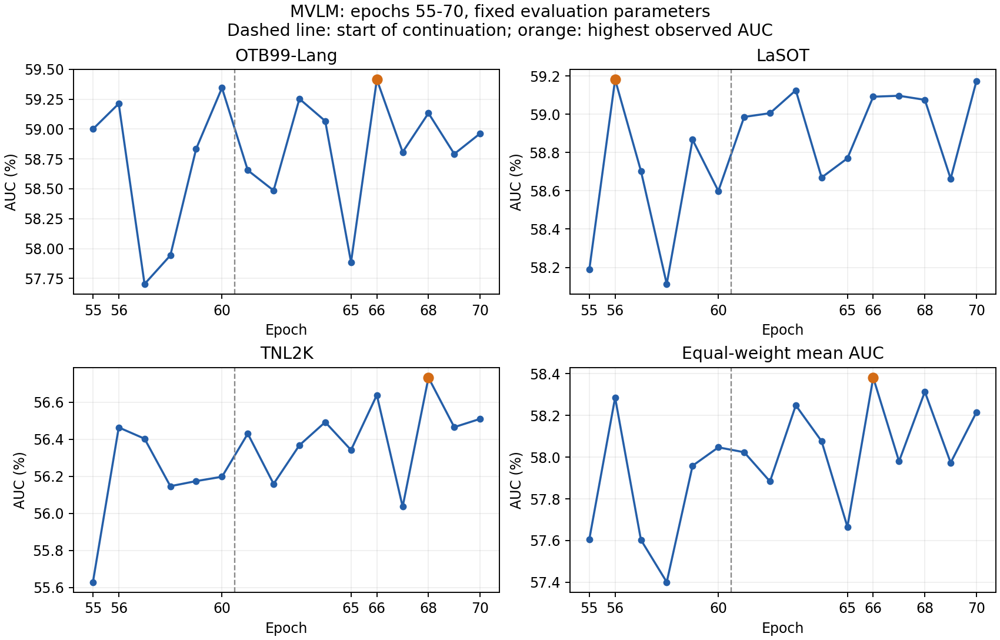

# MVLM 续训至第70轮：最终评测分析

评测于北京时间2026-11-03 03:25完成：E61～E70共30组，预测结果完整性检查全部通过。沿用main首帧真实框接口与计分方式、各数据集固定参数；TNL2K为700条。先使用GPU6、7，续训结束后加入GPU4、5，两组各24个视频进程（每卡12个、每进程batch1）。

## 判断

建议当前先停在70轮，保留E66作为已评测检查点中三集等权平均AUC最高的探索性模型。当前配方已进入收益较小、单轮波动明显的阶段，仍有轻微向好的迹象；现有数据不能证明已达到模型或训练配方的最高能力。

## 主要对照

| Epoch | OTB AUC | LaSOT AUC | TNL2K AUC | 三集等权平均 AUC |
| ---: | ---: | ---: | ---: | ---: |
| 56 | 59.213 | 59.181 | 56.463 | 58.286 |
| 60 | 59.344 | 58.599 | 56.197 | 58.047 |
| 61 | 58.655 | 58.986 | 56.430 | 58.024 |
| 62 | 58.486 | 59.006 | 56.159 | 57.883 |
| 63 | 59.253 | 59.125 | 56.367 | 58.249 |
| 64 | 59.067 | 58.670 | 56.492 | 58.076 |
| 65 | 57.886 | 58.770 | 56.342 | 57.666 |
| 66 | 59.415 | 59.092 | 56.638 | 58.381 |
| 67 | 58.807 | 59.097 | 56.036 | 57.980 |
| 68 | 59.133 | 59.075 | 56.732 | 58.314 |
| 69 | 58.792 | 58.663 | 56.465 | 57.973 |
| 70 | 58.963 | 59.174 | 56.510 | 58.216 |

- E66平均AUC为58.381，比此前最佳E56的58.286提高0.096个百分点；相对E56，OTB +0.202、LaSOT -0.090、TNL2K +0.175个百分点。
- 固定终点E70平均AUC为58.216，比续训起点E60提高0.169个百分点；OTB -0.382、LaSOT +0.575、TNL2K +0.312个百分点，收益并非所有数据集一致。
- E61～65平均57.980，E66～70平均58.173，后半段提高0.193个百分点。说明并非完全没有进步，但相邻检查点相关，不能将这五个轮次当作五次独立重复实验。
- 在已完成的原评测及续训评测中，单集最高分别为OTB E66=59.415、LaSOT E56=59.181、TNL2K E68=56.732。不能把三个不同模型的各集最高值拼成同一模型成绩。
- 原E60训练loss约0.6881，E70两卡日志均值约0.6333（下降约8%），训练IoU约85.90%→86.76%。训练拟合继续改善，但测试平均AUC改善有限，不能只根据loss下降决定追加轮数。
- 论文参考三集平均AUC为59.733，当前最高58.381，仍差约1.352个百分点；最近10轮带来的最佳值增益仅约0.096个百分点。

## 下一步建议与解释限制

优先保留E56、E60、E66、E68、E70用于对照，不自动继续到80或100轮。接下来优先核对作者真实全局/每卡batch与更新次数、初始化和数据版本、测试参数对自训权重的适配，结合失败视频定位差距；这些是待核实方向，尚未证明是差距原因。

若仍希望检验长训假设，可单独预先约定E70→E80作为有限预算实验，保持batch与当前低学习率，在固定节点评测，并在可用的独立验证设计上确定停止标准。本次尚未启动该实验。没有独立验证集时，不能把反复查看测试集得到的最好轮次解释为泛化最优。

E66是在多次查看测试集后选出的探索性最佳值，0.096个百分点增益尚未经多随机种子或不确定性分析确认。没有持续下降并不等于必须继续训练，也不能据此排除过拟合。

[完整AUC/PRE/NPR表](PAPER_CONTINUATION_TESTS_20261102.md)
