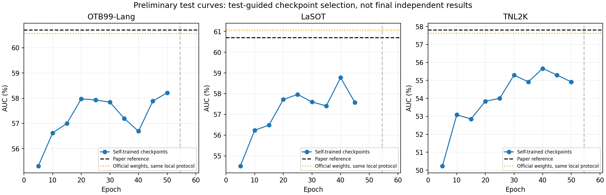

# 三数据集自训练模型：阶段性测试差距分析

分析时间：2026-11-01T22:16:10+08:00。粗测已完成29/36组；结果仍在更新。本报告不启动新训练、不改变当前评测队列。

结论：三套数据训练后，当前模型已接近论文成绩量级，但已测轮次仍有约2～3个百分点AUC差距，20轮之后收益显著变慢。训练目标改善不能直接推导测试性能；目前没有支持“已经失败”或“再测几个轮次一定追平”的证据。

## 当前最好成绩与趋势

| 数据集 | 当前最高分轮次 | 自训AUC | 论文参考AUC | 差距（百分点） | 同本地协议官方权重AUC |
| --- | ---: | ---: | ---: | ---: | ---: |
| OTB99-Lang | 50 | 58.21 | 60.70 | -2.49 | 60.56 |
| LaSOT | 40 | 58.77 | 60.70 | -1.93 | 61.06 |
| TNL2K | 40 | 55.67 | 57.80 | -2.13 | 57.62 |

这里列的是各数据集各自最高分，可能来自不同检查点，不能当作一个模型同时达到的三项成绩。论文与本地首帧计分存在口径差异；同本地协议官方权重是更可靠的对照。

## 对已保存预测的同视频诊断

固定第40轮作为已完成三个集合的诊断模型，分别与main历史官方权重相同参数、相同视频、相同计分规则比较。此处不是再按诊断结果选模型。main将第0帧真实框保存并计分，因此最早的实际预测是第1号帧（第二张图像），不能用第0帧评价自主定位能力。
| 数据集 | 自训E40 AUC / 官方AUC | 最早实际预测IoU≥0.5：自训 / 官方 (%) | 有效帧近乎跟丢比例：自训 / 官方 (%) | 官方更好 / 自训更好：视频数 |
| --- | ---: | ---: | ---: | ---: |
| OTB99-Lang | 56.69 / 60.56 | 58.33 / 64.58 | 13.57 / 7.93 | 26 / 22 |
| LaSOT | 58.77 / 61.06 | 57.14 / 58.93 | 23.22 / 21.39 | 180 / 100 |
| TNL2K | 55.67 / 57.62 | 61.95 / 66.95 | 21.73 / 20.41 | 482 / 212 |

“近乎跟丢”定义为有效标注帧上IoU<0.1，先计算每段视频比例再等权平均，排除人工填入的第0帧；不是直接测量丢失后重捕获能力，也不是因果结论。最早预测成功率只统计该帧GT有效的序列。
这些结果表明差距至少部分已存在于最早实际定位，并且有效帧的严重定位失败更多；不是仅仅由首帧计分方式或少数日志显示误差造成。LaSOT和TNL2K中官方胜出的视频占多数，差距较广泛；OTB较接近一半，少数大幅失败可能贡献较多均值差距。

## 已确认与仍需验证的因素

- 已确认训练完成75,000步，最终模型无非有限参数；当前推理加载审计没有非CLIP缺失键或多余键。W&B在线同步截断、GPU利用率未持续100%影响监控或效率，不能据此解释最终准确率差距。
- batch含义是重要未闭合条件。公开配置batch=80，公开loader将其直接用作每进程batch。若按四卡、每卡80执行，会得到全局320和约312次更新/轮；本次是全局80、1250次更新/轮。论文batch含义与作者实际运行未核实，不能断言作者一定使用全局320，也不能认定本次一定与作者优化过程一致。
- 本次两卡每卡40与论文四卡的每卡样本数、预测头BatchNorm统计不一定相同。即使全局batch相同，也不能证明逐步训练完全等价。
- 当前阈值和记忆参数来自官方权重在测试集上的历史搜索，新权重的置信度分布可能不同，因此未必最适合新模型；这只是待验证的解释。需要独立验证集校准，不能在同一测试集反复调参后称独立复现。
- 训练IoU来自GT扰动裁剪，在线测试还需要整图语言定位、连续帧状态和恢复。当前诊断支持检查这些差异，但这种训练/测试差别同样存在于原实现，不足以单独解释与官方权重的差距。
- TNL2K排除1条、VastTrack排除11条，另有44次采样异常重试；这些情况已记录，目前没有证据将约2～3个百分点主要归因于它们。数据镜像、标注修订、初始化版本与作者实际清单是否逐字节一致仍未完全证明。
- 当前是单次训练，尚无多种子实验，无法估计随机性对差距贡献多少；也不能承诺换seed或增加训练轮数可以补齐。

## 建议的下一步

1. 完成第55和60轮低学习率阶段的完整评测，再按已定策略做局部细测；细测用于定位高分区间，不会改变模型本身。
2. 先固定同协议官方权重对照和失败视频，核实作者实际global/per-GPU batch、预训练权重与数据清单；不要仅凭当前平台期就启动又一轮长训练。
3. 若需要对新权重做置信度校准，另建独立视频级验证划分或独立验证数据；本轮已训练全部VastTrack有效视频，旧500条留出集不能再当作独立验证。后续区分“公开参数固定复现”与“验证集校准后的模型”。

## 来源与文件

- [官方结果表与训练入口](https://github.com/inha-vllab/MVLM)。
- [官方原始配置](https://raw.githubusercontent.com/inha-vllab/MVLM/main/experiments/mvlm/mvlm_TF.yaml)。
- [官方loader的batch实现](https://raw.githubusercontent.com/inha-vllab/MVLM/main/lib/train/base_functions.py)。
- [训练完成报告](PAPER_TRAINING_RESULTS_20261101.md)；[实时测试报告](PAPER_CHECKPOINT_TESTS_20261101.md)。
- [同视频诊断JSON](paper_training_results_20261101/test_gap_analysis_20261101.json)，逐视频诊断文件为同目录 `gap_e40_*_per_sequence.json`。
