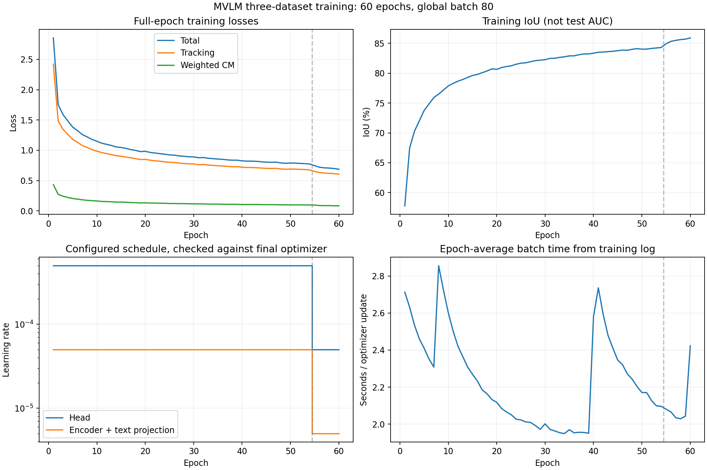
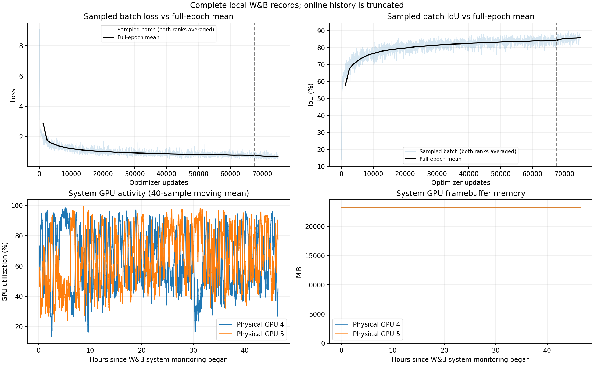

# MVLM 三数据集训练完成报告

整理时间：2026-11-01T12:44:39+08:00。本报告对应 `paper_reproduction_20261030_run01`，不是此前 VastTrack-only 实验。

<!-- WANDB-NOTICE-BEGIN -->
**监控同步说明：W&B在线历史仅到第42轮中段，页面为crashed；本地W&B记录、监督状态和最终检查点一致确认60轮正常完成。以下最终指标使用完整本地记录，详情见W&B核对章节。**
<!-- WANDB-NOTICE-END -->

## 完成情况

- 训练正常完成：60/60轮，75,000次优化器更新，退出码0；状态文件为 completed。
- 开始：2026-10-30 13:45:42；结束：2026-11-01 12:12:37（均为北京时间）。
- 监督程序记录的总墙钟时间：46.45小时，包含初始化、检查点保存和监控收尾；不是纯GPU计算时间。
- 物理GPU 4、5；每卡batch 40，全局batch 80；每卡2个数据加载worker，总计4个；无梯度累积，未启用AMP。
- [W&B曲线](https://wandb.ai/2896287267-hit/mvlm-reproduction/runs/7ln28ook)；[训练原始日志](/root/MVLM/output/paper_reproduction_20261030_run01/train.log)；[最终状态](/root/MVLM/output/paper_reproduction_20261030_run01/training_status.json)。

## 训练数据

| 数据集 | 实际训练视频数 | 准备审计中的图像帧数 | 抽样比例 |
| --- | ---: | ---: | ---: |
| LaSOT | 1,120 | 2,831,982 | 1 |
| VastTrack | 46,825 | 3,805,290 | 1 |
| TNL2K | 1,299 | 727,345 | 1 |

每轮100,000个随机抽样训练样本，60轮共6,000,000次样本抽取，不代表600万个不同视频或不同帧；1:1:1为抽样概率，未逐数据集累计实际抽样次数。
TNL2K原始1,300条中跳过 `Fight_game_004-Done`，原文件保留；VastTrack有效清单在准备阶段排除了11条缺帧序列。实际序列顺序及哈希见运行目录 `split/` 与归档 `run_spec.json`。准备审计检查了目录、标注和语言，并抽查图像解码；未逐帧完整解码全部图像。
本次没有独立验证集。此前VastTrack-only留出的500条已参与本次训练，不能再用作独立验证。

## 模型、初始化与优化参数

- Template-free FastITPN-B + CLIP ViT-L/14 + CENTER；加载预训练FastITPN和CLIP，语言投影与CENTER随机初始化；没有加载论文发布的MVLM或旧自训练模型。
- CLIP冻结；可训练参数共89,442,309个，视觉骨干、文本投影和预测头参与优化。
- AdamW；预测头初始学习率5e-4，视觉编码器及文本投影5e-5；第54轮结束后乘0.1，第55～60轮分别使用5e-5和5e-6。已直接核对最终检查点，W&B终端简写的数值可能被舍入。
- weight decay=1e-4；梯度裁剪范数=0.1；drop path=0.1；基础seed=1234567890，并按rank偏移。
- 搜索输入224×224，搜索区域因子4.0，位置抖动3.5、尺度抖动0.5；训练使用真实框裁剪/监督，不能把训练IoU直接当作纯语言在线追踪成绩。
- 总损失：2×GIoU + 5×L1 + Focal + 0.5×CM；日志中的CM已经乘过0.5。

## 训练结果与曲线

第1轮到第60轮：总Loss由2.85454下降到0.68807，下降75.90%；训练IoU由57.78%上升至85.90%，提高28.12个百分点。
最终Tracking Loss=0.60570，加权CM Loss=0.08237。训练Loss最低和训练IoU最高的完整轮次分别为第60、60轮；这不是按测试性能选出的最优模型。
下表的Loss/IoU采用完整本地W&B记录的两卡平均精确值，并与每轮两卡训练日志交叉核对；耗时采用训练日志。显示值保留5位小数。未记录按LaSOT/VastTrack/TNL2K分别拆分的训练Loss，也未记录可用于分析的梯度范数曲线。

| Epoch | 总Loss | Tracking Loss | 加权CM Loss | 训练IoU (%) | 秒/更新 |
| ---: | ---: | ---: | ---: | ---: | ---: |
| 1 | 2.85454 | 2.42214 | 0.43240 | 57.78 | 2.713 |
| 2 | 1.75399 | 1.48137 | 0.27262 | 67.47 | 2.632 |
| 3 | 1.58841 | 1.34675 | 0.24167 | 70.27 | 2.535 |
| 4 | 1.48356 | 1.26197 | 0.22160 | 72.01 | 2.461 |
| 5 | 1.38255 | 1.17882 | 0.20374 | 73.75 | 2.410 |
| 6 | 1.32372 | 1.13005 | 0.19367 | 74.83 | 2.352 |
| 7 | 1.25948 | 1.07696 | 0.18252 | 75.92 | 2.308 |
| 8 | 1.21949 | 1.04576 | 0.17372 | 76.48 | 2.856 |
| 9 | 1.17909 | 1.01089 | 0.16820 | 77.18 | 2.723 |
| 10 | 1.14843 | 0.98519 | 0.16323 | 77.86 | 2.601 |
| 11 | 1.11690 | 0.96143 | 0.15547 | 78.29 | 2.502 |
| 12 | 1.09798 | 0.94528 | 0.15270 | 78.66 | 2.420 |
| 13 | 1.07890 | 0.92882 | 0.15008 | 78.95 | 2.364 |
| 14 | 1.05461 | 0.91057 | 0.14405 | 79.29 | 2.308 |
| 15 | 1.04629 | 0.90092 | 0.14537 | 79.61 | 2.269 |
| 16 | 1.03158 | 0.88928 | 0.14230 | 79.79 | 2.233 |
| 17 | 1.01151 | 0.87543 | 0.13608 | 80.08 | 2.185 |
| 18 | 0.99778 | 0.86203 | 0.13575 | 80.36 | 2.164 |
| 19 | 0.97722 | 0.84651 | 0.13071 | 80.71 | 2.133 |
| 20 | 0.98307 | 0.85064 | 0.13243 | 80.64 | 2.118 |
| 21 | 0.96499 | 0.83641 | 0.12859 | 80.94 | 2.085 |
| 22 | 0.95529 | 0.82609 | 0.12919 | 81.11 | 2.066 |
| 23 | 0.94476 | 0.81989 | 0.12486 | 81.23 | 2.051 |
| 24 | 0.93444 | 0.80929 | 0.12514 | 81.49 | 2.027 |
| 25 | 0.92348 | 0.80201 | 0.12147 | 81.66 | 2.023 |
| 26 | 0.91929 | 0.79805 | 0.12124 | 81.74 | 2.012 |
| 27 | 0.90776 | 0.78862 | 0.11914 | 81.92 | 2.009 |
| 28 | 0.90052 | 0.78093 | 0.11959 | 82.09 | 1.992 |
| 29 | 0.89264 | 0.77629 | 0.11635 | 82.18 | 1.972 |
| 30 | 0.89089 | 0.77459 | 0.11629 | 82.25 | 2.002 |
| 31 | 0.87647 | 0.76181 | 0.11465 | 82.47 | 1.972 |
| 32 | 0.88044 | 0.76502 | 0.11542 | 82.49 | 1.963 |
| 33 | 0.86827 | 0.75653 | 0.11174 | 82.64 | 1.954 |
| 34 | 0.86159 | 0.74997 | 0.11162 | 82.73 | 1.949 |
| 35 | 0.85527 | 0.74414 | 0.11113 | 82.89 | 1.970 |
| 36 | 0.85015 | 0.74099 | 0.10917 | 82.90 | 1.953 |
| 37 | 0.84149 | 0.73378 | 0.10771 | 83.08 | 1.956 |
| 38 | 0.83635 | 0.72761 | 0.10874 | 83.21 | 1.955 |
| 39 | 0.83689 | 0.72933 | 0.10756 | 83.22 | 1.951 |
| 40 | 0.82566 | 0.72076 | 0.10490 | 83.34 | 2.580 |
| 41 | 0.82093 | 0.71599 | 0.10494 | 83.50 | 2.736 |
| 42 | 0.82083 | 0.71546 | 0.10538 | 83.53 | 2.593 |
| 43 | 0.81779 | 0.71186 | 0.10594 | 83.61 | 2.480 |
| 44 | 0.81001 | 0.70618 | 0.10383 | 83.65 | 2.411 |
| 45 | 0.80410 | 0.70182 | 0.10228 | 83.76 | 2.346 |
| 46 | 0.80180 | 0.69966 | 0.10214 | 83.86 | 2.321 |
| 47 | 0.80373 | 0.70114 | 0.10259 | 83.83 | 2.271 |
| 48 | 0.79139 | 0.69159 | 0.09980 | 83.99 | 2.243 |
| 49 | 0.78548 | 0.68625 | 0.09922 | 84.10 | 2.203 |
| 50 | 0.78936 | 0.69028 | 0.09908 | 84.01 | 2.171 |
| 51 | 0.78826 | 0.68874 | 0.09951 | 84.03 | 2.170 |
| 52 | 0.78303 | 0.68429 | 0.09873 | 84.14 | 2.127 |
| 53 | 0.78008 | 0.68221 | 0.09787 | 84.21 | 2.099 |
| 54 | 0.77323 | 0.67606 | 0.09716 | 84.30 | 2.096 |
| 55 | 0.74517 | 0.65075 | 0.09441 | 84.92 | 2.081 |
| 56 | 0.72071 | 0.63203 | 0.08868 | 85.32 | 2.066 |
| 57 | 0.70978 | 0.62382 | 0.08596 | 85.49 | 2.035 |
| 58 | 0.70674 | 0.61982 | 0.08691 | 85.62 | 2.029 |
| 59 | 0.69880 | 0.61482 | 0.08398 | 85.69 | 2.043 |
| 60 | 0.68807 | 0.60570 | 0.08237 | 85.90 | 2.423 |

<!-- WANDB-DETAILS-BEGIN -->
## W&B历史核对与资源分析

核对在线run `7ln28ook` 与原始本地 `run-7ln28ook.wandb`；在线快照取于 2026-11-01T04:40:26.753951+00:00。

| 来源 | 状态 | 完整轮平均记录 | 最大优化步数 |
| --- | --- | ---: | ---: |
| W&B在线API | crashed；summary仍为training | 41轮 | 51,500 |
| W&B本地原始文件 | exit_code=0，最终summary为completed | 60轮 | 75,000 |
| 训练监督程序和最终检查点 | completed，退出码0 | 60轮 | 75,000 |

在线历史最后时间为北京时间 2026-10-31T21:44:01.811677+08:00，已经进入第42轮，但只有前41轮的完整轮均值。不能用在线最后的Loss或crashed标签代表训练最终结果。同步日志反复出现代理 `127.0.0.1:17891` 连接被拒绝，支持“上传中断”的解释；线上crashed状态具体如何形成未进一步核定。本次只读核对和归档，未重传或改写线上run。
本地共有7,620条history记录，其中60条完整轮均值、3,780个抽样batch指标、3,780个单步资源记录。抽样间隔为20次更新且每轮末尾另记一次；train指标经过两卡平均，runtime和PyTorch显存仅由rank0记录。
60轮W&B精确均值与两卡训练日志核对，四项指标最大绝对差为4.82e-06，在日志5位小数的舍入误差范围内。主报告指标CSV和轮平均曲线使用完整本地W&B值，耗时仍来自训练日志。

第54轮至第60轮，总Loss从0.773225降到0.688067，下降11.01%；训练IoU提高1.60个百分点。降学习率后训练目标仍有改善，不能由此推断测试指标一定提高。
W&B学习率采样确认：首次低学习率记录出现在第55轮、第67,520次更新；两组从5e-4/5e-5变为5e-5/5e-6，与最终优化器一致。

| 物理训练卡 | GPU利用率均值 / 中位数 / P95 (%) | 系统显存P95 / 最大值 (MiB) | 温度均值 / 最大值 (°C) | 功率均值 (W) |
| --- | ---: | ---: | ---: | ---: |
| GPU 4 | 64.4 / 100.0 / 100.0 | 23250 / 23250 | 60.6 / 66 | 197.9 |
| GPU 5 | 65.0 / 100.0 / 100.0 | 23250 / 23250 | 59.7 / 66 | 196.3 |

资源统计来自完整本地W&B系统采样，覆盖W&B监控时段中的数据等待、通信和检查点保存，不等于覆盖模型初始化及监督程序收尾的全部阶段；均值是有效采样点的算术平均。系统显存包含驱动缓存等开销，与PyTorch allocated不同。GPU利用率表示采样期间GPU工作的时间比例，不代表计算单元数量或峰值算力使用率；NCCL通信也可能贡献利用率。仅统计本次物理4、5号训练卡，不把其他任务所在的卡计入训练。
抽样rank0单步耗时：中位数1.917秒、P95 4.121秒、均值2.175秒，最后一次1.188秒。该字段是采样当前batch的墙钟耗时，不是整轮平均；clips_per_second_rank0也只按每卡batch40计算，不能当全局吞吐量。
总墙钟口径的全局平均样本速度为6,000,000 / 167215.6 ≈ 35.88个训练样本/秒。不能把抽样单步耗时直接用于完整任务ETA。

补充证据：[W&B精确逐轮CSV](paper_training_results_20261101/wandb_epoch_metrics.csv)、[核对与资源统计JSON](paper_training_results_20261101/wandb_crosscheck.json)、[在线run快照](paper_training_results_20261101/wandb_run.json)、[完整本地history](paper_training_results_20261101/wandb_local_history.json)。
<!-- WANDB-DETAILS-END -->

## 检查点与异常

- 已核对第1～60轮检查点连续完整，共60个，合计60.02 GiB。检查点含模型、优化器及训练状态；冻结CLIP权重省略，加载时使用相同预训练CLIP。
- [最终第60轮检查点](/root/MVLM/output/paper_reproduction_20261030_run01/checkpoints/train/mvlm/mvlm_TF_paper_reproduction/MVLM_ep0060.pth.tar)；其中epoch=60、global_step=75000；全部已保存浮点模型张量检查为有限值。
- 第60轮检查点SHA256：`b19c2ac489e26baaf0ef8dd488e7f8c1c69938c200344bf6ae04009a00570327`。
- 训练过程中多次观测每卡约23,251 MiB/24,576 MiB显存占用；W&B主卡最终记录的PyTorch峰值分配约22,303 MiB。两者统计口径不同，也不是双卡全程采样的显存峰值。
- 日志共44次 `data sampler bug: float object is not iterable`；采样器捕获异常后重新抽样，未中断训练。原日志没有序列名/堆栈，无法据此定位具体样本，完整性准备检查也不能排除所有运行时采样问题。
- 日志训练崩溃标记0次、Traceback标记0次，最终正常退出。

## 结果边界与后续评测

Loss和训练IoU改善说明优化目标得到学习；没有独立验证曲线，无法仅凭这些指标判断泛化、过拟合或论文复现成功。训练参数中的全局batch80是对论文未明确全局/每卡含义的解释，两卡的BatchNorm条件也与论文四卡不同。
当前外部评测、论文参考行和逐轮三集AUC/PRE/NPR见[持续更新的测试报告](PAPER_CHECKPOINT_TESTS_20261101.md)。测试采用main首帧真实框协议和历史测试集调参配置；现在按每5轮粗测、最高三集平均AUC附近细测，属于测试引导的探索性模型选择，不能把所选最高分称为独立测试成绩。

## 机器可读数据与原始证据

- [60轮指标CSV](paper_training_results_20261101/epoch_metrics.csv)；[汇总JSON](paper_training_results_20261101/summary.json)。
- [实际配置](paper_training_results_20261101/config.yaml)；[资源和数据清单审计](paper_training_results_20261101/run_spec.json)；[初始化审计](paper_training_results_20261101/initialization.json)。
- 完整源码快照及SHA256：`/root/MVLM/output/paper_reproduction_20261030_run01/source/`、`/root/MVLM/output/paper_reproduction_20261030_run01/source_sha256.json`。
- 早期训练启动记录：[PAPER_REPRODUCTION_TRAINING_20261030.md](PAPER_REPRODUCTION_TRAINING_20261030.md)。其中启动步数和早期W&B状态保留历史含义，最终结果以本报告和最终状态为准。
